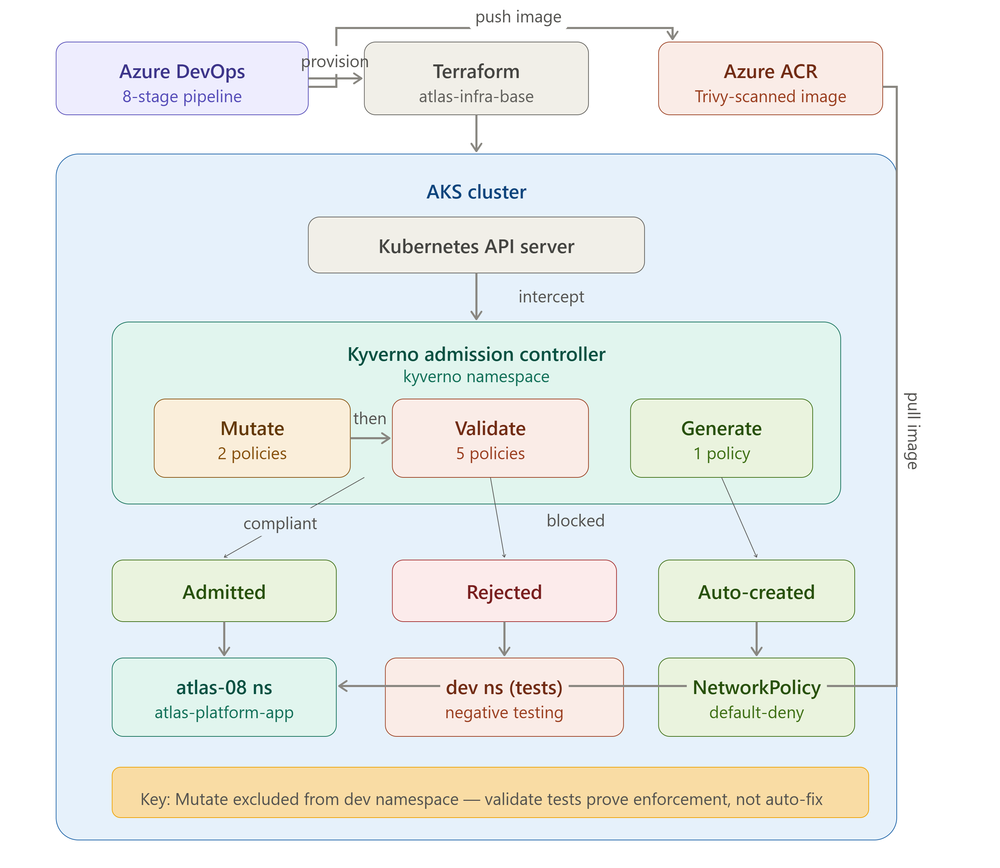
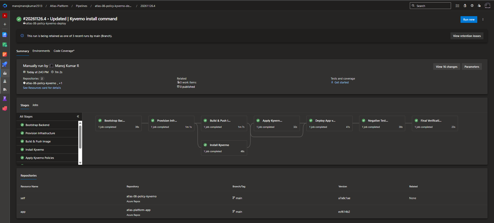
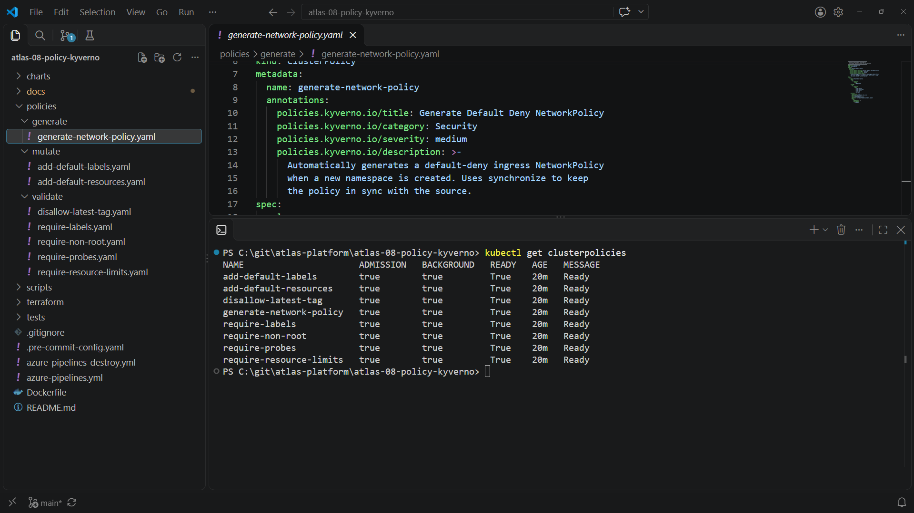
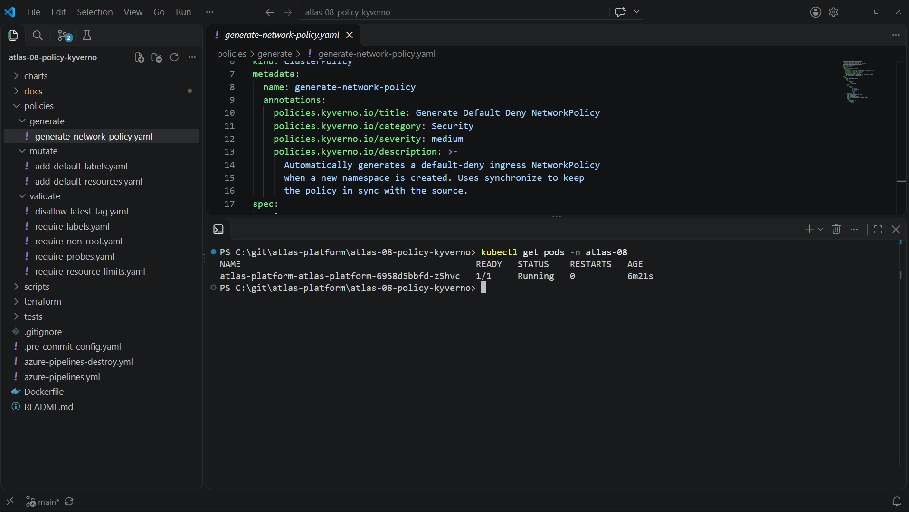
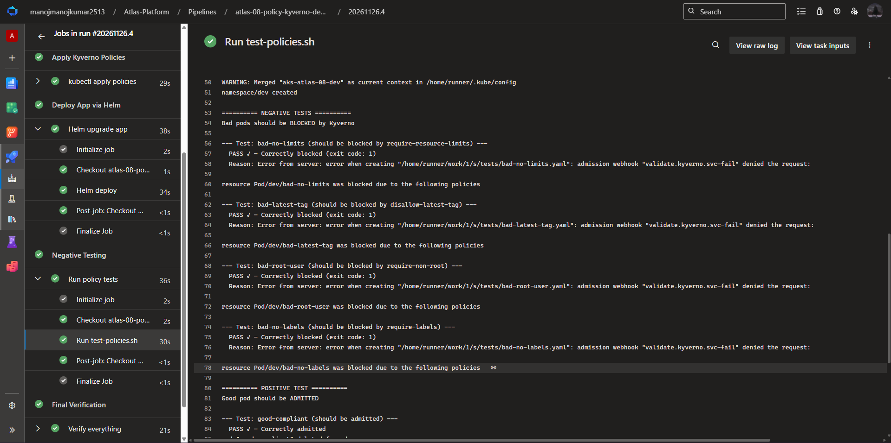
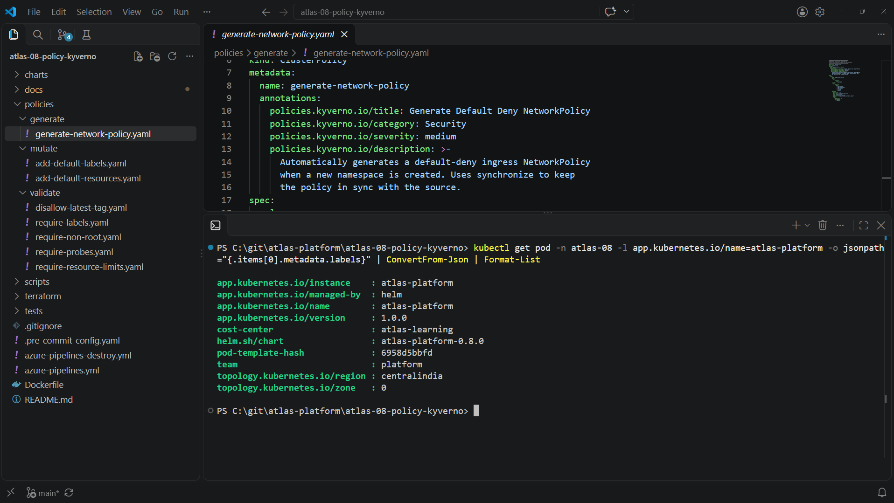
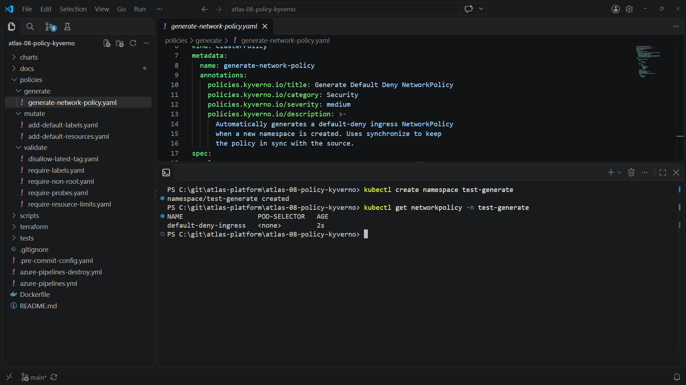
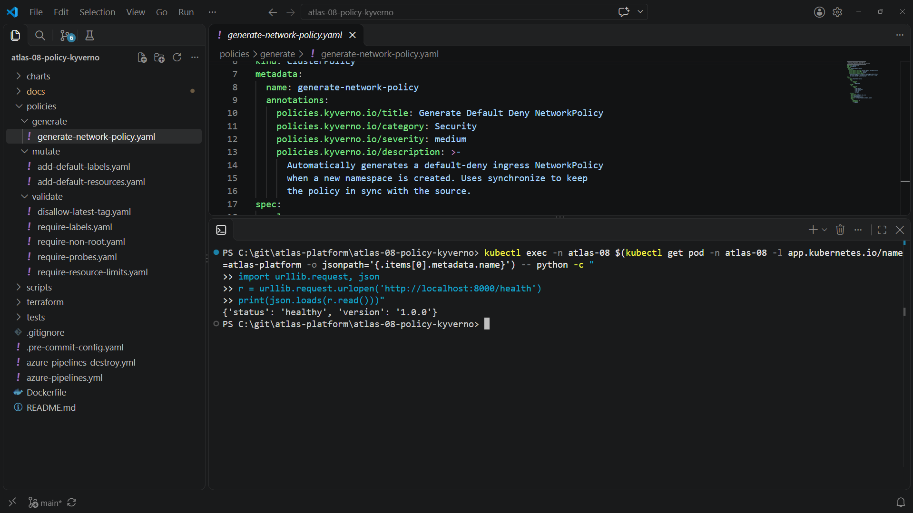

# Atlas-08: Policy Enforcement with Kyverno on AKS

> **Project 8 of 11** in the [Atlas Platform Portfolio](https://github.com/manoj-2606) — a production-grade Azure cloud engineering portfolio targeting Senior DevOps/Platform Engineer roles in Europe.

## Problem

Projects P1–P7 deploy workloads into Kubernetes with **zero admission control**. Any pod can be deployed with any configuration — no guardrails, no enforcement, no safety net:

- **Anyone can deploy `nginx:latest`.** No tag pinning, no version traceability. "What's running in production?" becomes a guessing game.
- **Containers run as root by default.** A compromised container gets root access to the node's filesystem. This is the most common Kubernetes privilege escalation vector.
- **No resource limits required.** One pod can consume the entire node's CPU and memory, starving every other workload. On a B2s node, that's a cluster-wide outage.
- **No standard labels enforced.** Without `app.kubernetes.io/name` and `managed-by`, you can't filter, monitor, or trace ownership of anything.
- **No health probes required.** Pods with no liveness/readiness probes sit in `Running` state even when the application inside has crashed.

These aren't best practices to aspire to — they're **admission-time gates** that should block non-compliant workloads before they ever reach the cluster.

## Solution

This project adds **Kyverno as a Kubernetes-native policy engine** that enforces standards at admission time:

- **5 Validate policies** — block pods that violate standards (latest tag, no limits, root user, missing labels, no probes)
- **2 Mutate policies** — auto-inject default labels and resource limits for pods that don't specify them
- **1 Generate policy** — auto-create a default-deny NetworkPolicy when any new namespace is created
- **Negative testing baked into the pipeline** — 4 bad pods that MUST be blocked + 1 good pod that MUST be admitted + 1 generate test
- **Pipeline deploys the app AFTER policies are active** — proving the app itself passes all policy checks

The paradigm shift: **the cluster rejects non-compliant workloads before they exist, not after they cause damage.**

## Architecture

### Without vs With Admission Control

```
WITHOUT POLICY ENGINE (P1–P7):
  Developer → kubectl apply → API Server → etcd → Pod runs
  (Any YAML accepted. No validation beyond K8s schema.)

WITH KYVERNO (P8):
  Developer → kubectl apply → API Server → Kyverno Webhook → ✓ Admit / ✗ Deny
  (Kyverno intercepts every admission request via ValidatingWebhookConfiguration)

  If pod has latest tag     → BLOCKED (disallow-latest-tag)
  If pod has no limits      → BLOCKED (require-resource-limits)
  If pod runs as root       → BLOCKED (require-non-root)
  If pod has no labels      → BLOCKED (require-labels)
  If pod has no probes      → BLOCKED (require-probes)
  If pod is fully compliant → ADMITTED
```

### Pipeline Flow

```
┌──────────────────────────────────────────────────────────────────────┐
│                                                                      │
│  ADO Pipeline (azure-pipelines.yml)                                  │
│       │                                                              │
│       ├── Stage 1: Bootstrap (tfstate storage)                       │
│       ├── Stage 2: Infrastructure (Terraform → AKS + ACR)           │
│       ├── Stage 3a: Build (Docker → Trivy → ACR push) ──┐           │
│       ├── Stage 3b: InstallKyverno (Helm install)      ──┤ PARALLEL  │
│       ├── Stage 4: ApplyPolicies (kubectl apply)                     │
│       │       ├── 5× Validate ClusterPolicies                       │
│       │       ├── 2× Mutate ClusterPolicies                         │
│       │       └── 1× Generate ClusterPolicy                         │
│       ├── Stage 5: DeployApp (Helm → atlas-08 namespace)             │
│       │       └── App must PASS all validate policies to deploy      │
│       ├── Stage 6: TestPolicies (Negative testing)                   │
│       │       ├── 4× bad pods → MUST be blocked                     │
│       │       ├── 1× good pod → MUST be admitted                    │
│       │       └── 1× generate test → NetworkPolicy auto-created     │
│       └── Stage 7: Verify (final checks)                             │
│                                                                      │
└──────────────────────────────────────────────────────────────────────┘
```



### Kyverno Component Map

```
kyverno namespace:
  ├── kyverno-admission-controller     → Webhook: intercepts API requests, validates/mutates
  ├── kyverno-background-controller    → Processes background scans + generate policies
  ├── kyverno-cleanup-controller       → Cleans up expired resources
  └── kyverno-reports-controller       → Generates PolicyReports (audit trail)

ClusterPolicies (cluster-wide, not namespaced):
  ├── disallow-latest-tag              → Validate: blocks latest + untagged images
  ├── require-labels                   → Validate: enforces app.kubernetes.io/name + managed-by
  ├── require-resource-limits          → Validate: enforces CPU + memory limits
  ├── require-non-root                 → Validate: enforces runAsNonRoot: true
  ├── require-probes                   → Validate: enforces liveness + readiness httpGet probes
  ├── add-default-labels               → Mutate: injects team + cost-center labels
  ├── add-default-resources            → Mutate: injects default CPU/memory if missing
  └── generate-network-policy          → Generate: creates default-deny NetworkPolicy on new NS

atlas-08 namespace (app):
  ├── Deployment: atlas-platform-app
  ├── Service: atlas-platform-app
  └── ConfigMap: atlas-platform-config

dev namespace (tests):
  └── Test pods applied and verified here
```

### Policy Matrix

| Policy | Type | Action | Severity | What It Blocks / Does |
|--------|------|--------|----------|----------------------|
| disallow-latest-tag | Validate | Enforce | High | Pods with no tag OR `latest` tag |
| require-labels | Validate | Enforce | Medium | Pods missing `app.kubernetes.io/name` or `managed-by` |
| require-resource-limits | Validate | Enforce | High | Pods without CPU/memory limits |
| require-non-root | Validate | Enforce | High | Pods without `runAsNonRoot: true` |
| require-probes | Validate | Enforce | Medium | Pods without liveness/readiness httpGet probes |
| add-default-labels | Mutate | — | — | Auto-injects `team` + `cost-center` labels |
| add-default-resources | Mutate | — | — | Auto-injects CPU/memory requests+limits |
| generate-network-policy | Generate | — | Medium | Auto-creates default-deny NetworkPolicy on new namespace |

### Infrastructure

| Component | Sizing | Why |
|-----------|--------|-----|
| AKS | 1× Standard_B2s (4GB) | Kyverno is lightweight (~1GB total) — single node sufficient |
| Kyverno Admission Controller | 384Mi limit | Webhook processing — heaviest component |
| Kyverno Background Controller | 256Mi limit | Generate policies + background scans |
| Kyverno Cleanup Controller | 128Mi limit | Lightest — periodic cleanup only |
| Kyverno Reports Controller | 256Mi limit | PolicyReport generation |
| atlas-platform-app | 256Mi limit | The workload proving policy compliance |
| ACR | Basic SKU | Image storage |

## Repo Structure

```
atlas-08-policy-kyverno/
├── terraform/
│   ├── main.tf                          # atlas-infra-base module (1× B2s)
│   ├── variables.tf
│   ├── outputs.tf
│   └── environments/
│       └── dev.tfvars                   # 1 node, K8s 1.31.2, cost tags
│
├── Dockerfile                           # Multi-stage, non-root, vendor approach
│
├── charts/
│   └── atlas-platform/                  # App Helm chart (policy-compliant)
│       ├── Chart.yaml
│       ├── values.yaml                  # ★ All values tuned for policy compliance
│       └── templates/
│           ├── _helpers.tpl
│           ├── deployment.yaml
│           ├── service.yaml
│           └── configmap.yaml
│
├── policies/
│   ├── validate/
│   │   ├── disallow-latest-tag.yaml     # ★ Block latest + untagged images
│   │   ├── require-labels.yaml          # ★ Enforce K8s standard labels
│   │   ├── require-resource-limits.yaml # ★ Enforce CPU/memory limits
│   │   ├── require-non-root.yaml        # ★ Enforce non-root containers
│   │   └── require-probes.yaml          # ★ Enforce liveness + readiness probes
│   ├── mutate/
│   │   ├── add-default-labels.yaml      # ★ Auto-inject team + cost-center labels
│   │   └── add-default-resources.yaml   # ★ Auto-inject default CPU/memory
│   └── generate/
│       └── generate-network-policy.yaml # ★ Auto-create default-deny on new NS
│
├── tests/
│   ├── bad-no-limits.yaml               # ★ MUST be blocked (no resource limits)
│   ├── bad-latest-tag.yaml              # ★ MUST be blocked (uses latest tag)
│   ├── bad-root-user.yaml               # ★ MUST be blocked (runs as root)
│   ├── bad-no-labels.yaml               # ★ MUST be blocked (missing labels)
│   └── good-compliant.yaml              # ★ MUST be admitted (fully compliant)
│
├── scripts/
│   ├── infra.sh                         # Terraform init/plan/apply + output vars
│   ├── build.sh                         # Docker build + Trivy + ACR push
│   ├── install-kyverno.sh               # Helm install Kyverno with pinned version
│   ├── apply-policies.sh                # kubectl apply all policies
│   ├── test-policies.sh                 # Negative testing (4 bad + 1 good + 1 generate)
│   └── destroy.sh                       # Terraform destroy + verify
│
├── azure-pipelines.yml                  # Deploy (8 stages, external .sh scripts)
├── azure-pipelines-destroy.yml          # Destroy (approval gate)
│
├── docs/
│   ├── pipeline-stages.png              # Screenshot: 8 stages passed
│   ├── kyverno-policies.png             # Screenshot: All 8 ClusterPolicies Ready
│   ├── app-deployed.png                 # Screenshot: Pod running in atlas-08
│   ├── negative-test-results.png        # Screenshot: 4 blocked + 1 admitted
│   ├── mutate-demo.png                  # Screenshot: Auto-injected labels
│   ├── generate-networkpolicy.png       # Screenshot: NetworkPolicy auto-created
│   └── app-health-check.png             # Screenshot: /health endpoint response
│
├── .pre-commit-config.yaml
├── .gitignore
└── README.md
```

## How to Run

### Prerequisites
- Azure subscription with Contributor access
- Azure DevOps project `Atlas-Platform` with `MI-ADO-API` service connection
- Terraform state backend: `atlastfstate2606` in `rg-atlas-tfstate`
- `atlas-platform-app` repo in ADO (multi-repo checkout)

### Deploy

```bash
# 1. Push code to ADO
git remote add ado https://dev.azure.com/manojmanojkumar2513/Atlas-Platform/_git/atlas-08-policy-kyverno
git push ado main

# 2. Set ADO repo permissions (Build Service → Contribute + Bypass)

# 3. Create environments: atlas-08-deploy (no approval), atlas-08-destroy (approval)

# 4. Create pipeline → azure-pipelines.yml → Run
#    Stage 1: Bootstrap (tfstate storage)
#    Stage 2: Infrastructure (Terraform → AKS 1 node + ACR)
#    Stage 3a: Build (Docker → Trivy → SBOM → ACR push)        ─┐
#    Stage 3b: InstallKyverno (Helm install Kyverno 3.6.4)      ─┤ PARALLEL
#    Stage 4: ApplyPolicies (8 ClusterPolicies)
#    Stage 5: DeployApp (Helm → atlas-08 namespace)
#    Stage 6: TestPolicies (4 bad blocked + 1 good admitted + 1 generate)
#    Stage 7: Verify (final checks)
```

### Manual Verification (after pipeline completes)

```bash
# Get AKS credentials
az aks get-credentials --resource-group rg-atlas-08-dev --name aks-atlas-08-dev

# Check Kyverno pods
kubectl get pods -n kyverno
# Should show: admission-controller, background-controller, cleanup-controller, reports-controller

# List all policies
kubectl get clusterpolicies
# Should show 8 policies, all with READY=True

# Check policy details
kubectl get clusterpolicies -o custom-columns=NAME:.metadata.name,READY:.status.ready,ACTION:.spec.validationFailureAction

# Demo: Negative Test (try deploying a bad pod manually)
kubectl apply -f tests/bad-latest-tag.yaml
# Expected: Error from server: admission webhook denied the request
# "Using 'latest' tag is not allowed."

# Demo: Positive Test (deploy a compliant pod)
kubectl apply -f tests/good-compliant.yaml
# Expected: pod/good-compliant created
kubectl delete pod good-compliant -n dev

# Demo: Generate Policy (create a new namespace)
kubectl create namespace test-generate
kubectl get networkpolicy -n test-generate
# Expected: default-deny-ingress NetworkPolicy auto-created
kubectl delete namespace test-generate

# Verify app is running
kubectl get pods -n atlas-08
kubectl exec -n atlas-08 $(kubectl get pod -n atlas-08 -l app.kubernetes.io/name=atlas-platform -o jsonpath='{.items[0].metadata.name}') -- python -c "
import urllib.request, json
r = urllib.request.urlopen('http://localhost:8000/health')
print(json.loads(r.read()))"
```

### Destroy

```bash
# Create pipeline → azure-pipelines-destroy.yml → Run
# Requires approval on atlas-08-destroy environment
# Verify: Azure Portal → Resource Groups → rg-atlas-08-dev gone
```

### State Lock Recovery

```bash
az storage blob lease break \
  --blob-name atlas-08.tfstate \
  --container-name tfstate \
  --account-name atlastfstate2606
```

## Kyverno Concepts

| Concept | What It Is | Why It Matters |
|---------|-----------|----------------|
| ClusterPolicy | Cluster-wide policy (not namespaced). Contains rules that match resources and validate/mutate/generate them | The core unit of policy enforcement — without it, Kyverno does nothing |
| Validate | Rule type that checks if a resource matches a pattern. If not, admission is denied | Prevents non-compliant workloads from ever reaching the cluster |
| Mutate | Rule type that modifies a resource before it's persisted. Uses `patchStrategicMerge` | Auto-injects defaults so teams don't need to remember every field |
| Generate | Rule type that creates a new resource when a trigger resource is created | Automates boilerplate (e.g., NetworkPolicy on every new namespace) |
| Enforce vs Audit | `validationFailureAction: Enforce` blocks, `Audit` only logs to PolicyReport | Start with Audit in production, move to Enforce after validation |
| Background Scan | Kyverno scans existing resources against new policies (not just new admissions) | Catch pre-existing violations when you deploy a new policy |
| Exclude Namespaces | Rules can exclude system namespaces (kube-system, kyverno) from enforcement | Prevents policies from breaking cluster infrastructure components |
| Negative Testing | Deploying pods that SHOULD fail and verifying they're blocked | Proves policies work — a policy that isn't tested is a policy that doesn't exist |

## Negative Testing — Why It Matters

P8 introduces **negative testing** as a first-class pipeline stage. This is NOT "run tests after deploy." This is "prove that the guardrails work by deliberately crashing into them."

| Test Pod | What It Violates | Expected Result |
|----------|-----------------|-----------------|
| `bad-no-limits.yaml` | require-resource-limits | ✗ BLOCKED — no CPU/memory limits |
| `bad-latest-tag.yaml` | disallow-latest-tag | ✗ BLOCKED — uses `nginx:latest` |
| `bad-root-user.yaml` | require-non-root | ✗ BLOCKED — no `runAsNonRoot: true` |
| `bad-no-labels.yaml` | require-labels | ✗ BLOCKED — missing required labels |
| `good-compliant.yaml` | (none) | ✓ ADMITTED — passes all policies |
| New namespace | generate-network-policy | ✓ NetworkPolicy auto-created |

**Each bad pod violates exactly ONE policy** while satisfying all others. This isolates which policy is doing the blocking — critical for debugging.

**The pipeline fails if ANY negative test passes.** A bad pod getting admitted means the policy is broken.

## Pipeline Pattern — External Scripts (continued from P7)

P8 continues the external `.sh` script pattern from P7, adding a new dimension: **policy testing as a pipeline stage**.

| Project | Pipeline Pattern | Why Different |
|---------|-----------------|---------------|
| P1 | Inline Bash + PowerShell validation | Prove range — mixed tooling |
| P2 | Bash `.sh` files | Reusable across pipelines |
| P3 | PowerShell `.ps1` engine scripts | Windows/PS competency |
| P4 | YAML templates with parameters | ADO-native reusability |
| P5 | Reusable GitHub Actions workflows | GHA-native reusability |
| P6 | Inline AzureCLI bash | Simple stack, complex monitoring |
| P7 | External `.sh` scripts (5 files) | Testable, readable, debuggable |
| **P8** | **External `.sh` scripts + negative test stage** | **Policy testing as CI/CD gate** |

**What P8 adds:** A dedicated `TestPolicies` stage that runs `test-policies.sh` — a script that deliberately applies non-compliant manifests and verifies they're blocked. The pipeline fails if Kyverno lets a bad pod through. This turns policy enforcement from "trust me, it works" into "here's the proof."

## DevSecOps — Baked In

| Practice | Implementation |
|----------|---------------|
| Secrets scanning | gitleaks pre-commit hook — secrets never reach Git |
| OIDC authentication | MI-ADO-API — zero stored credentials |
| Image scanning | Trivy — zero CRITICAL CVEs reach ACR |
| SBOM generation | `trivy --format cyclonedx` — supply chain visibility |
| Non-root containers | `runAsNonRoot: true`, `runAsUser: 1000` (enforced by Kyverno) |
| Read-only filesystem | `readOnlyRootFilesystem: true` |
| Resource limits enforced | Kyverno `require-resource-limits` — no pod deploys without limits |
| Image tag pinning enforced | Kyverno `disallow-latest-tag` — no `latest` or untagged images |
| Label standards enforced | Kyverno `require-labels` — every pod is traceable |
| Health probes enforced | Kyverno `require-probes` — every pod is monitored |
| Default-deny networking | Kyverno auto-generates deny-all ingress NetworkPolicy |

## FinOps — Baked In

| Practice | Implementation |
|----------|---------------|
| Cost tags | Every resource: project, environment, team, cost-center, created-by, managed-by, destroy-by |
| Right-sizing | 1× Standard_B2s (not D-series), Basic ACR, 30GB OS disk |
| Ephemeral infra | Created and destroyed same day — `destroy-by: end-of-day` tag |
| Kyverno sizing | Admission 384Mi, Background 256Mi, Cleanup 128Mi, Reports 256Mi — B2s-safe |
| Auto-label injection | Mutate policy auto-adds `cost-center` label — FinOps traceability |

## Cost

| Resource | Cost/Day |
|----------|----------|
| AKS control plane | Free |
| 1× Standard_B2s node | ~₹3.5 (~$0.04/hr × 8hr) |
| ACR Basic | ~₹14 (~$0.17/day) |
| VNet / NSG | Free |
| **Total** | **~₹40-50 per execution** |

## Evidence

<!-- POST-EXECUTION: Replace placeholders with actual screenshots -->

**Pipeline — all 8 stages passed (Build ∥ InstallKyverno in parallel):**



**Kyverno Policies — all 8 ClusterPolicies Ready:**



**App Deployed — pod running in atlas-08 namespace:**



**Negative Test Results — 4 blocked + 1 admitted in pipeline logs:**



**Mutate Demo — auto-injected labels on a pod:**



**Generate Policy — NetworkPolicy auto-created in new namespace:**



**App Health Check — /health endpoint responding:**



## Versus Previous Projects

| Aspect | P1 (IaC) | P2 (Container) | P3 (Helm) | P4 (ADO) | P5 (GHA) | P6 (Observability) | P7 (GitOps) | P8 (Policy) |
|--------|----------|----------------|-----------|----------|----------|-------------------|-------------|-------------|
| Pipeline Pattern | Inline Bash+PS | Bash .sh files | PS .ps1 engines | YAML templates | Reusable workflows | Inline AzureCLI | External .sh scripts | **External .sh + test stage** |
| Deployment Model | Terraform | Docker build | Helm install | Helm via template | Helm via workflow | Helm inline | ArgoCD pull-based | **Helm + Kyverno gates** |
| AKS Nodes | 1 | 0 | 1 | 1 | 1 | 2 | 1 | **1** |
| Admission Control | No | No | No | No | No | No | No | **Yes — Kyverno** |
| Policy Enforcement | No | No | No | No | No | No | No | **Yes — 8 ClusterPolicies** |
| Negative Testing | No | No | No | No | No | No | No | **Yes — 6 test cases** |
| Auto-Mutation | No | No | No | No | No | No | No | **Yes — labels + resources** |
| Auto-Generation | No | No | No | No | No | No | No | **Yes — NetworkPolicy** |
| Self-Healing | No | No | No | No | No | No | Yes | No |
| Drift Detection | No | No | No | No | No | No | Yes | No |
| New CRDs | None | None | None | None | None | ServiceMonitor, PrometheusRule | Application, AppProject | **ClusterPolicy, PolicyReport** |
| Parallel Stages | No | No | No | No | No | No | Yes (Build ∥ InstallArgoCD) | **Yes (Build ∥ InstallKyverno)** |

## Lessons Learned

### What is Admission Control?

Admission control is a **Kubernetes API server mechanism** that intercepts every request to create, update, or delete a resource BEFORE it's persisted to etcd. Think of it as a bouncer at a club door — the API server checks your YAML against a set of rules, and if it doesn't pass, your resource never enters the cluster.

Kubernetes has two types of admission webhooks:

| Type | When It Runs | What It Can Do |
|------|-------------|----------------|
| MutatingAdmissionWebhook | First | Modify the resource (add labels, inject sidecars, set defaults) |
| ValidatingAdmissionWebhook | Second | Accept or reject the resource (can't modify it) |

**Order matters:** Mutate runs before Validate. So Kyverno can inject default resource limits (mutate), and then another rule can validate that limits exist (validate). The mutation happens before validation checks.

### What is Kyverno?

Kyverno is a **Kubernetes-native policy engine** that uses Custom Resource Definitions (CRDs) to define policies as YAML. Unlike OPA/Gatekeeper, which requires learning Rego (a separate policy language), Kyverno policies are plain Kubernetes YAML — the same language you already use for everything else.

**Key components:**

| Component | What It Does | Pod Name |
|-----------|-------------|----------|
| Admission Controller | Intercepts API requests via webhook, runs validate/mutate rules | `kyverno-admission-controller` |
| Background Controller | Runs generate rules, background scans against existing resources | `kyverno-background-controller` |
| Cleanup Controller | Cleans up temporary resources, handles policy cleanup | `kyverno-cleanup-controller` |
| Reports Controller | Generates PolicyReport/ClusterPolicyReport CRDs (audit trail) | `kyverno-reports-controller` |

**How Kyverno processes a request:**

1. User runs `kubectl apply -f pod.yaml`
2. API server receives the request
3. API server calls Kyverno's webhook (MutatingAdmissionWebhook first)
4. Kyverno runs all matching mutate rules → modifies the resource
5. API server calls Kyverno's webhook again (ValidatingAdmissionWebhook)
6. Kyverno runs all matching validate rules → accept or deny
7. If accepted, resource is persisted to etcd
8. Background controller runs generate rules if triggered

### Kyverno vs OPA/Gatekeeper — Why Kyverno?

```
OPA/Gatekeeper:
  ✓ Mature, widely adopted, CNCF graduated
  ✗ Requires learning Rego — a completely separate policy language
  ✗ Policies are code, not YAML — harder to review in PRs
  ✗ No mutate or generate capabilities (validate only)
  ✗ Higher learning curve for K8s-focused teams

Kyverno:
  ✓ Policies are YAML — no new language to learn
  ✓ Validate + Mutate + Generate in one engine
  ✓ Kubernetes-native — matches the team's existing skills
  ✓ Lower barrier to adoption
  ✓ CNCF graduated (same level as Gatekeeper)
  ✗ Less flexible for complex cross-resource logic
  ✗ Smaller ecosystem of community policies (but growing fast)
```

**For this portfolio:** Kyverno is the right choice because it demonstrates policy enforcement with the YAML skills the team already has. In an interview, you can say: "I chose Kyverno over OPA because our team already thinks in YAML, and Kyverno covers validate, mutate, and generate in one tool."

### Three Policy Types Explained

**Validate — The Bouncer**
```
"Does this pod meet our standards? If not, reject it."

spec:
  validationFailureAction: Enforce    # Enforce = block, Audit = log only
  rules:
    - validate:
        message: "CPU and memory limits are required."
        pattern:
          spec:
            containers:
              - resources:
                  limits:
                    cpu: "?*"         # ?* = must exist and be non-empty
                    memory: "?*"
```

**Mutate — The Fixer**
```
"This pod is missing default labels. I'll add them before it's persisted."

spec:
  rules:
    - mutate:
        patchStrategicMerge:
          metadata:
            labels:
              +(team): "platform"       # + = only add if key doesn't exist
              +(cost-center): "atlas"    #   (won't overwrite existing values)
```

**Generate — The Automator**
```
"A new namespace was created. I'll auto-create a default-deny NetworkPolicy in it."

spec:
  rules:
    - generate:
        synchronize: true              # Keep generated resource in sync
        apiVersion: networking.k8s.io/v1
        kind: NetworkPolicy
        namespace: "{{request.object.metadata.name}}"   # The new namespace
```

### Why Mutate Policies Exclude the Dev Namespace

The mutate policies (`add-default-labels`, `add-default-resources`) exclude the `dev` namespace where negative tests run. Here's why:

If mutate runs on `dev`, then `bad-no-limits.yaml` (which has no resource limits) would get default limits injected by the mutate policy BEFORE the validate policy checks it. The validate check would then PASS because limits now exist — defeating the entire negative test.

**The fix:** Exclude `dev` from mutate policies so negative tests in `dev` hit validate rules without mutation. In production, you'd apply mutate everywhere and test in a dedicated `policy-test` namespace.

### Errors Encountered

| # | Stage | Error | Root Cause | Fix | Time Lost |
|---|-------|-------|------------|-----|-----------|
| 1 | | | | | |

<!-- POST-EXECUTION: Fill in actual errors encountered during pipeline execution -->

## Interview Summary

### Primary Story — Policy Enforcement / Admission Control
*"I enforce Kubernetes security and operational standards at admission time using Kyverno. I have 8 ClusterPolicies covering validate, mutate, and generate patterns. Every pod must have pinned image tags, resource limits, non-root security context, standard labels, and health probes — or it's rejected before it reaches the cluster. I prove this works with negative testing in the pipeline: 4 bad pods that MUST be blocked, 1 good pod that MUST pass, and a generate test that verifies NetworkPolicy auto-creation."*

### Secondary Story — Negative Testing as CI/CD Gate
*"I don't just deploy policies and trust they work. My pipeline has a dedicated TestPolicies stage that deliberately applies non-compliant manifests and verifies they're blocked by Kyverno. If ANY bad pod gets through, the pipeline fails. This is the same approach used in security compliance — you don't just prove something works, you prove it fails correctly."*

### Questions This Project Answers

- What is Kubernetes admission control? How do webhooks work?
- What is Kyverno and how does it differ from OPA/Gatekeeper?
- Explain validate, mutate, and generate policy types
- What is `validationFailureAction: Enforce` vs `Audit`?
- How do you test policies? What is negative testing?
- What is a ClusterPolicy vs a namespaced Policy?
- How does Kyverno handle existing resources when a new policy is deployed?
- What is the `+()` operator in Kyverno mutate rules?
- How do you prevent mutate policies from interfering with validate tests?
- What is `synchronize: true` in generate policies?
- How do you exclude system namespaces from policy enforcement?
- What are PolicyReports and how do you use them for auditing?
- How do you roll out policies safely in production? (Audit → Enforce)

## Related Projects

| Project | Focus | Repo |
|---------|-------|------|
| P1 — IaC Foundation | Terraform + AKS from scratch | [atlas-01-iac-foundation](https://github.com/manoj-2606/atlas-01-iac-foundation) |
| P2 — Container Security | Docker + Trivy + SBOM | [atlas-02-container-security](https://github.com/manoj-2606/atlas-02-container-security) |
| P3 — Helm Deployment | Helm charts + AKS deployment | [atlas-03-helm-deployment](https://github.com/manoj-2606/atlas-03-helm-deployment) |
| P4 — Pipeline Mastery | YAML templates + multi-env CI/CD (ADO) | [atlas-04-pipeline-mastery-ado](https://github.com/manoj-2606/atlas-04-pipeline-mastery-ado) |
| P5 — GHA + OIDC | GitHub Actions + OIDC Federation | [atlas-05-gha-oidc](https://github.com/manoj-2606/atlas-05-gha-oidc) |
| P6 — Observability | Prometheus + Grafana + Kubecost + SLO | [atlas-06-observability-stack](https://github.com/manoj-2606/atlas-06-observability-stack) |
| P7 — GitOps ArgoCD | ArgoCD + Pull-based deployment | [atlas-07-ArgoCD-GitOps](https://github.com/manoj-2606/atlas-07-ArgoCD-GitOps) |
| **P8 — Policy Kyverno** | **Kyverno + Admission control** | **atlas-08-policy-kyverno** |

---

**Built by [Manoj Kumar R](https://github.com/manoj-2606) — Atlas Platform Portfolio**
**Target: Senior DevOps / Platform Engineer — Netherlands | Finland | Sweden | Ireland**